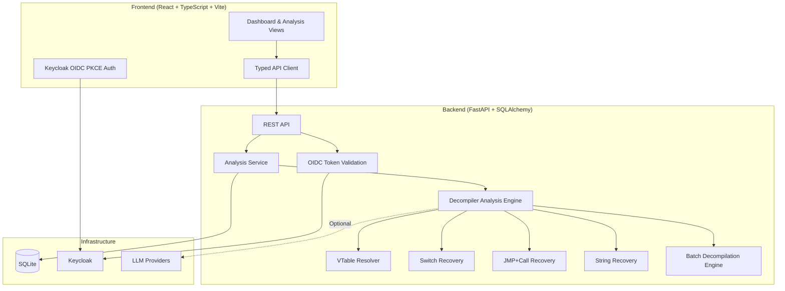

# Nexus Workbench - AI-Assisted Reverse Engineering

> Work in progress. This checkpoint may be incomplete or fail tests. See PLAN.md and STATUS.md before use.


Alan Vo | AI & Machine Learning

> **AI-assisted reverse engineering workbench for decompiler analysis**

## Problem Statement

Reverse engineers using Ghidra face persistent decompiler limitations when analyzing C++ binaries: indirect vtable function calls appear as opaque index lookups (`(*this->vtable[6])(local_20)`), switch statements compiled to jump tables are not recovered as structured `switch` constructs, JMP-with-PUSH return address patterns are misidentified as tail calls, and string data in different memory segments fails to display inline. These issues (Ghidra Issues #516, #2628, #5747, #4865) force analysts to manually cross-reference listings, slowing analysis of large codebases.

## Solution

Nexus Workbench provides an AI-enhanced analysis layer that ingests decompiler output, applies deterministic pattern recognition algorithms to resolve ambiguities, and optionally uses LLMs for explanatory annotations grounded in actual binary artifacts. The workbench addresses:

1. **VTable Resolution** (#516): Resolve indirect calls through vtable layout reconstruction
2. **Switch Recovery** (#2628): Reconstruct `switch` statements from comparison-chain jump tables
3. **JMP+Call Recovery** (#5747): Correct CFG by recovering PUSH+JMP return addresses
4. **Cross-Segment String Recovery** (#4865): Associate string data across memory segments
5. **Scalable Batch Decompilation** (#2791): Parallel decompilation with shared analysis cache

## Architecture



## Features

- **Authentication**: OIDC Authorization Code flow with PKCE via Keycloak, SAML broker support, role-based access (viewer/operator/admin)
- **Analysis Management**: Create, list, filter, paginate, and track decompiler analyses
- **Domain Engine**: Deterministic pattern recognition for vtable, switch, JMP+call, and string recovery
- **LLM Integration**: Optional explanatory annotations (OpenAI-compatible, Anthropic, Gemini, Ollama)
- **Persistence**: SQLite with async SQLAlchemy, UTC timestamps, audit trail
- **Docker**: Multi-container deployment with health checks
- **CI/CD**: Automated testing and container builds

## Quick Start

### Prerequisites
- Docker and Docker Compose
- Python 3.12 (for local development)
- Node 24 (for local development)

### Using Docker Compose

```bash
# Copy environment template
cp .env.example .env
# Edit .env with your settings (minimum: SECRET_KEY)

# Start all services
docker compose up -d

# Access:
# Frontend: http://127.0.0.1:3000
# Backend API: http://127.0.0.1:8000
# Keycloak: http://127.0.0.1:8080 (admin/admin)
```

### Local Development

**Backend:**
```bash
cd backend
python3 -m venv .venv
source .venv/bin/activate
pip install -r requirements.txt
cp ../.env.example .env
# Edit .env
uvicorn app.main:app --reload --host 127.0.0.1 --port 8000
```

**Frontend:**
```bash
cd frontend
npm install
cp ../.env.example .env
# Edit .env with VITE_API_URL=http://127.0.0.1:8000
npm run dev
```

### Running Tests

**Backend:**
```bash
cd backend
SECRET_KEY=test-secret-key-for-testing-purposes-only-32chars PYTHONPATH=. python -m pytest -v
```

**Frontend:**
```bash
cd frontend
npm test
```

## API Reference

### Authentication
- `GET /auth/config` - Get Keycloak configuration
- `GET /auth/login` - Initiate OIDC login (returns authorization URL)
- `GET /auth/callback` - OIDC callback handler
- `POST /auth/logout` - Logout
- `GET /auth/me` - Get current user info

### Analyses
- `POST /analyses` - Create new analysis (operator+)
- `GET /analyses` - List analyses with pagination/filtering
- `GET /analyses/{id}` - Get analysis details
- `PATCH /analyses/{id}` - Update analysis (operator+)
- `DELETE /analyses/{id}` - Delete analysis (operator+)

### Analysis Types
| Type | Description | Ghidra Issue |
|------|-------------|--------------|
| `vtable_resolution` | Resolve indirect vtable calls | #516 |
| `switch_recovery` | Recover switch from jump tables | #2628 |
| `jmp_call_recovery` | Fix JMP+PUSH return addresses | #5747 |
| `string_recovery` | Cross-segment string detection | #4865 |
| `batch_decompilation` | Parallel decompilation scaling | #2791 |

## Configuration

Key environment variables (see `.env.example`):

| Variable | Description | Required |
|----------|-------------|----------|
| `SECRET_KEY` | Session encryption key (32+ chars) | Yes |
| `DATABASE_URL` | SQLite async URL | Yes |
| `KEYCLOAK_URL` | Keycloak base URL | Yes |
| `KEYCLOAK_REALM` | Keycloak realm name | Yes |
| `KEYCLOAK_CLIENT_ID` | OIDC client ID | Yes |
| `KEYCLOAK_CLIENT_SECRET` | OIDC client secret | Yes |
| `OIDC_DISCOVERY_URL` | OIDC discovery endpoint | Yes |
| `LLM_API_KEY` | LLM provider API key | No |
| `LLM_PROVIDER` | Provider type (openai-compatible, anthropic, gemini, ollama) | No |
| `LLM_MODEL` | Model identifier | No |
| `LLM_BASE_URL` | Provider base URL | No |
| `DEMO_MODE` | Local-only demo mode (binds localhost) | No |

### LLM Provider Configuration

| Provider | Base URL | Notes |
|----------|----------|-------|
| OpenAI | `https://api.openai.com/v1` | Default |
| Anthropic | `https://api.anthropic.com` | Messages API |
| Gemini | `https://generativelanguage.googleapis.com` | GenerateContent |
| Ollama | `http://localhost:11434/v1` | Local |
| OpenRouter | `https://openrouter.ai/api/v1` | Multi-model |
| LiteLLM | `http://localhost:4000` | Proxy |

## Keycloak / SAML Setup

1. Import `keycloak/realm-export.json` via Keycloak admin console
2. Configure SAML Identity Provider in Keycloak:
   - Identity Providers → Add SAML v2.0
   - Set SP Entity ID, SSO URL, certificates
   - Map SAML attributes to Keycloak user attributes
3. Update realm roles: `viewer`, `operator`, `admin`

## Security Considerations

- **Demo Mode**: Binds to localhost only; startup refuses demo mode in production
- **Token Handling**: Access tokens never persisted to localStorage; PKCE verifiers in sessionStorage only
- **Credentials**: No secrets committed; all via environment variables
- **CORS**: Restricted to configured origins
- **Session**: HttpOnly SameSite cookies for backend session auth
- **Validation**: OIDC tokens validated for signature, issuer, audience, nonce
- **LLM Keys**: Server-side only; never exposed to frontend

## Deployment

### TLS Reverse Proxy (Required for Production)

```nginx
server {
    listen 443 ssl http2;
    server_name nexus.example.com;

    ssl_certificate /etc/letsencrypt/live/nexus.example.com/fullchain.pem;
    ssl_certificate_key /etc/letsencrypt/live/nexus.example.com/privkey.pem;

    location / {
        proxy_pass http://127.0.0.1:3000;
        proxy_set_header Host $host;
        proxy_set_header X-Forwarded-Proto https;
        proxy_set_header X-Forwarded-For $proxy_add_x_forwarded_for;
    }

    location /api/ {
        proxy_pass http://127.0.0.1:8000/;
        proxy_set_header Host $host;
        proxy_set_header X-Forwarded-Proto https;
    }

    location /auth/ {
        proxy_pass http://127.0.0.1:8000/auth/;
        proxy_set_header Host $host;
        proxy_set_header X-Forwarded-Proto https;
    }
}
```

### Backup/Restore

```bash
# Backup
docker compose exec backend sqlite3 /app/data/nexus.db .dump > backup.sql

# Restore
docker compose exec -T backend sqlite3 /app/data/nexus.db < backup.sql
```

## AI/ML Evaluation

### Reproducible Baseline

The workbench implements deterministic algorithms for each analysis type. Evaluation uses synthetic binaries with known ground truth:

```bash
# Run evaluation (when implemented)
python -m nexus_workbench.eval --dataset synthetic_vtable --output results.json
```

### Metrics (Planned)

| Task | Metric | Target |
|------|--------|--------|
| VTable Resolution | Precision/Recall | >90% |
| Switch Recovery | Case Recovery Rate | >85% |
| JMP+Call Recovery | CFG Edge Accuracy | >95% |
| String Recovery | Cross-segment Recall | >80% |
| Batch Decompilation | Speedup (16 cores) | >10x |

### Failure Cases

- Stripped binaries without RTTI/symbols
- Obfuscated vtable layouts
- Non-standard calling conventions
- Extremely large binaries (>100k functions)

## Project Structure

```
nexus-workbench-alan-vo/
├── .github/workflows/ci.yml       # CI pipeline
├── backend/
│   ├── app/
│   │   ├── api/                   # REST endpoints
│   │   ├── core/                  # Config, DB, Auth
│   │   ├── models/                # SQLAlchemy models
│   │   ├── services/              # Domain logic (planned)
│   │   └── main.py                # FastAPI entrypoint
│   ├── tests/                     # Pytest tests
│   ├── Dockerfile
│   └── requirements.txt
├── frontend/
│   ├── src/
│   │   ├── api/                   # Typed API client
│   │   ├── components/            # React components
│   │   ├── hooks/                 # Custom hooks
│   │   ├── pages/                 # Page components
│   │   └── types/                 # TypeScript types
│   ├── Dockerfile
│   ├── nginx.conf
│   └── package.json
├── keycloak/
│   └── realm-export.json          # Keycloak realm config
├── compose.yaml                   # Docker Compose
├── .env.example
├── pyproject.toml
├── portfolio.json
├── README.md
├── LICENSE
├── CHANGELOG.md
└── PLAN.md
```

## License

MIT License - Copyright (c) 2025 Alan Vo <alanvo@gmail.com>

## Contact

Alan Vo - alanvo@gmail.com

Project: https://github.com/ALANDVO/nexus-workbench-alan-vo